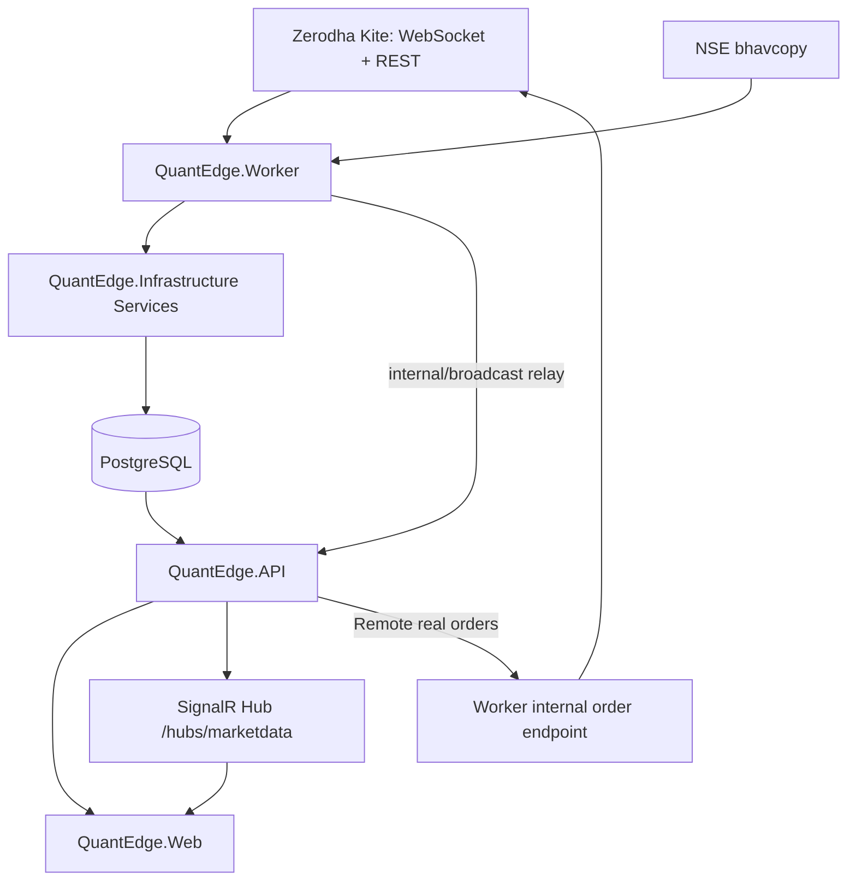

# QuantEdge Trading Platform

QuantEdge is a .NET 10 trading platform for the Indian equity market (NSE, via Zerodha Kite). It covers market data ingestion, technical indicators, signal generation, swing strategy scans, paper trading (auto and manual), real-money auto/manual trading through Zerodha, backtesting, reporting, and operational dashboards.

The solution contains:
- A Web API for data, trading, backtest, report, admin, and auth endpoints, plus the SignalR hub
- An MVC Web app for dashboards and operations
- A Worker host that runs background jobs selected by job type
- A shared Infrastructure layer (services, repositories, SQL, security, SignalR hub)
- A Domain layer (entities and domain exceptions)
- An xUnit test project

## 1. Solution Structure

Projects in `QuantEdge.slnx`:
- QuantEdge.API
- QuantEdge.Web
- QuantEdge.Worker
- QuantEdge.Infrastructure
- QuantEdge.Domain
- QuantEdge.Tests

High-level repository layout:

```text
QuantEdge/
  QuantEdge.API/              # ASP.NET Core Web API host (+ SignalR hub)
  QuantEdge.Web/              # ASP.NET Core MVC dashboard host
  QuantEdge.Worker/           # Background jobs host (Windows Service capable)
    Plan/                     # Per-job runbooks (feeds, history sync, reset, deployment, restarts)
  QuantEdge.Infrastructure/   # Services, repositories, SQL, security, SignalR hub
    Services/Backtest/        # Backtest engine, strategies, portfolio, data checks
    Persistence/              # schema / procedures / functions + data_fixes migrations
  QuantEdge.Domain/           # Domain entities and exceptions
  QuantEdge.Tests/            # xUnit + Moq unit tests
  Plan/                       # Design plans (trade conditions, swing redesign, multi-broker, ...)
  linuxservicesetup.md        # Linux systemd setup guide
  windowserivcesetup.md       # Windows service setup guide
  signal_dashboard_flow_rules.md
  swing_trading_logic.md
```

## 2. Architecture Overview



Core design characteristics:
- Layered structure (Domain + Infrastructure + Hosts)
- Dependency injection through the `AddMarketDataServices` ServiceCollection extension
- Dapper + Npgsql persistence with SQL procedures/functions
- SignalR for live push updates; the Worker relays broadcasts to the API hub over HTTP
- Background jobs selected by command-line job type
- Serilog logging per host (log file label includes the job type for Worker)
- Token-based API access control between Web and API
- Single-instance Postgres advisory-lock lease for real-money workers

## 3. What Each Project Does

### QuantEdge.API
Primary REST API and SignalR host.

Startup behavior:
- Registers controllers, Swagger, health checks (PostgreSQL), SignalR, CORS, memory cache
- Uses `AddMarketDataServices(..., isApiHost: true)`
- Applies path base `/api`
- `PaperTradingExceptionMiddleware` maps paper trading domain exceptions to responses
- `ApiAccessTokenMiddleware` requires a valid API access token on every non-`[AllowAnonymous]` endpoint (`ApiAuth:Enforce = false` only logs would-be rejections)
- HTTPS redirection is skipped in Development so the Web UI's cross-origin calls aren't redirected
- Exposes `/health` (JSON) and maps the SignalR hub at `/hubs/marketdata`

Controller modules:

| Area | Controller | Highlights |
|---|---|---|
| Auth | AuthController | login, register, change-password |
| | ZerodhaAuthController | login-url, callback, session-status, credentials, ddpi-status |
| | RolePermissionController | get/update role → page permissions |
| | UserController | summary, list, CRUD, reset-password |
| Market data | MarketDataController | stocks, stock-details, day-quote, instruments, chart-data, weekly-pnl, history reset/purge, memory-stats |
| | MarketRegimeController | current market regime |
| | SectorController | sector overview and detail |
| | FavoriteSymbolController | per-user favorite symbols |
| | DataCoverageController | coverage summary/list/export, update/delete/bulk delete, sector mapping |
| | CandleSummaryController | summary and symbols |
| Signals & rules | TradingSignalController | on-demand evaluate and stock verdict |
| | TradeConditionsController | configurable trade condition profiles (get/update/reset) |
| | StrategyRulesController | strategy rule parameters |
| | TradeLogicController | trade logic rule catalog |
| Paper trading | PaperTradingController | account, positions, orders, history, settings, reset |
| | AutoTradeController | auto paper settings, toggle, dashboard, logs, reset |
| | ManualPaperTradeController | manual paper buy/short, limit orders + cancel, position levels (target/SL/trailing), close, dashboard, history |
| Real trading | RealTradeController | settings, toggle, toggle-short, dashboard, live positions, logs, trade history, symbol journey, manual buy/sell/buy-back, square-off, kill switch, order resync |
| | ReconciliationController | broker vs. local position reconciliation and issues |
| Swing | SwingTradingController | settings, dashboard, Nifty status, ETF list, slots, slot recommendations, run intraday/job, backfill |
| Backtest | BacktestController | queue run, list runs, run detail, trades (JSON/CSV), delete |
| Reporting | ReportController | performance, paged trades/periods, export |
| | NotificationController | today and history |
| Ops | HolidayController | holiday CRUD and cache refresh |
| | LogController | log files, content, logs by date |
| | InternalBroadcastController | Worker → hub relay (shared-secret protected) |

### QuantEdge.Web
MVC dashboard and operations UI.

Startup behavior:
- Cookie auth (`QuantEdge.Auth`, sliding expiration) with page-level permissions (`IPagePermissionService`)
- Named HttpClient `QuantEdgeApi` pointed at `ApiBaseUrl`; `ApiServiceTokenHandler` attaches the API access token to every call
- Uses `AddMarketDataServices` for shared services where needed

Web controllers: Home, Account, Token, AutoTrading, PaperTrading, RealTrading, SwingTrading, Backtest, Report, Reconciliation, Notifications, TradeConditions, TradeLogic, Sector, DataCoverage, CandleSummary, ManageHistory, Holiday, Log, User, RolePermission.

### QuantEdge.Worker
Background host that selects job(s) from the first non-flag argument, else `JobType` config, else `marketdatafeed`. Runs as a Windows service (service name `Worker_<jobType>`).

| Job type | Hosted workers |
|---|---|
| `marketdatafeed` | MarketDataFeedWorker, NseBhavcopyWorker, DailyCandleFinalizeWorker, BacktestWorker |
| `marketdatafeed:<tf>` (e.g. `:1m`) | MarketDataFeedWorker only (per-timeframe process) |
| `history`, `history:<tf>` | HistoricalDataSyncWorker |
| `instrumentsync` | InstrumentSyncWorker |
| `swingintraday` | SwingTradingIntradayJobWorker |
| `autotrade` / `autotradescan` | Auto paper scan + monitor, auto real scan + monitor, RealOrderChargesWorker, Manual paper workers (short square-off, limit orders, auto exit), InternalRealOrderEndpointWorker |
| `clearcache` | ClearCacheWorker |
| `todayreset` / `todayhistoryreset` / `historyreset` / `reset` | HistoryResetWorker |

Workers:
- **MarketDataFeedWorker** – market-hours-aware live WebSocket stream, candle building, reconnect handling
- **NseBhavcopyWorker** – loads NSE's official end-of-day bhavcopy from 18:30 IST, catches up missed days, runs split/bonus checks
- **DailyCandleFinalizeWorker** – makes the last completed trading day's 1d candles final from Kite after the close
- **BacktestWorker** – runs queued backtests one at a time from stored candles only (1 low-priority thread in market hours, up to 4 outside)
- **HistoricalDataSyncWorker** – detects and backfills missing historical candles for active symbols
- **InstrumentSyncWorker** – instrument master sync on startup (if `RunInstrumentsSyncImmediately`) and Mondays 08:00 IST
- **SwingTradingIntradayJobWorker** – swing scan on 30-minute slots (:15 and :45)
- **AutoTradeSignalScanWorker / AutoTradePositionMonitorWorker** – auto paper trading: 15-minute scans, position monitoring and exits
- **AutoRealTradeSignalScanWorker / AutoRealPositionMonitorWorker** – real-money auto trading (long and short) through Zerodha, guarded by `RealMoneyWorkerLease`
- **RealOrderChargesWorker** – after 15:45 IST stores actual Zerodha charges for the day's filled real orders (virtual contract note)
- **ManualLimitOrderWorker** – fills/expires pending manual paper limit orders from stored 1m candles
- **ManualAutoExitWorker** – closes manual paper positions on target / stop loss / trailing stop from stored 1m candles
- **ManualShortSquareOffWorker** – intraday square-off of manual paper shorts (default 15:15 IST)
- **InternalRealOrderEndpointWorker** – Kestrel listener that places real orders forwarded by the API from this server's Zerodha-registered IP
- **HistoryResetWorker** – targeted symbol/timeframe/date-range reset and rebuild
- **ClearCacheWorker** – clears the memory cache and exits

Manual paper workers only touch `manual_paper_*` tables and never Auto Paper / Auto Real positions.

### QuantEdge.Infrastructure
Shared implementation layer:
- **Extensions** – DI registration (`AddMarketDataServices`), Serilog setup (`AddQuantEdgeLogging`)
- **Security** – `ApiAccessToken` and `ApiAccessTokenMiddleware`
- **Services**
  - Market data: Zerodha WebSocket/Kite broker, historical data, candle builder, market data processor, instrument sync, NSE bhavcopy, corporate actions, day quotes, live quote recorder, market hours
  - Analysis: indicator calculator/service, signal engine and score, stock verdict, market regime engine, sector dashboard, trade condition rules, strategy rules
  - Swing: swing decision engine (long and short), trade rules, rule catalog, slot recommendations
  - Paper trading: paper trading service, matching engine, order validator, position closer, auto trade, manual paper trade
  - Real trading: auto real trade service, real order gateway (Local / Remote), fill resolver, guards, charges calculator, Postgres lock service, position reconciliation, Kite failure handling, broker API event recorder
  - Backtest: engine, portfolio, universe, data checks, logic audit, and strategies (`SCORE`, `MOMENTUM_DAILY`, `INTRADAY_ORB`)
  - Reporting and notifications, caching, hub broadcast (Local / Remote)
- **Persistence** – connection factory, Dapper repositories, and SQL assets:
  - `schema.sql`, `stored_procedures.sql`, `functions.sql`
  - `stock_sector_data.sql` (sector seed data)
  - `migration_buy_short_logging_followup.sql`
  - `data_fixes/` – dated incremental migrations (e.g. trade condition profiles, swing short suggestions, backtest short side, strategy rule parameters, NSE corporate action checks)
- **Hubs** – SignalR `MarketDataHub`

### QuantEdge.Domain
Domain entities and exceptions:
- Market: MarketCandle, MarketIndicator, TradingSignal, StockMaster, IndianHoliday
- Users: AppUser
- Paper: PaperAccount, PaperOrder, PaperPosition, PaperTradeHistory, PaperTradingEnums
- Auto paper: AutoTradeSettings, AutoTradeExecutionLog
- Manual paper: ManualPaperTradeSettings, ManualPaperTradeExecutionLog
- Real: RealOrder, RealPosition, RealTradeHistory, RealTradeSettings, RealTradeExecutionLog
- Strategy: SwingStrategySettings, SwingRuleParameters, TradeConditionProfile
- Exceptions: PaperTradingExceptions

### QuantEdge.Tests
xUnit + Moq unit tests covering swing rules (long/short, trailing, breakouts), trade conditions, backtests (strategy rules, short selling), auto paper/real short handling, manual paper limit orders and auto exit, candle building, real order gateway, NSE bhavcopy, instrument reconcile, notifications, reports, API access tokens, and Kite margin caching.

## 4. Database and SQL Layer

Database engine: PostgreSQL (TimescaleDB-ready schema style).

SQL files:
- `Persistence/schema.sql` – table definitions, legacy migration blocks, indexes
- `Persistence/stored_procedures.sql` – insert/upsert procedures
- `Persistence/functions.sql` – read/query functions
- `Persistence/data_fixes/*.sql` – dated follow-up migrations, applied in date order after the base scripts

Data model highlights:
- Timeframe-specific candle tables: `market_candles_1m/5m/15m/60m/1d`
- Timeframe-specific indicator tables: `market_indicators_1m/5m/15m/60m/1d`
- Trading signals, instrument master (`stock_master`), sectors
- Zerodha sessions/credentials, holidays, users and role permissions
- Paper (`paper_*`), manual paper (`manual_paper_*`) and real trading tables
- Swing strategy settings, slot recommendations, trade condition profiles
- Backtest runs and trades, notifications, broker API events

## 5. Runtime Flows

Typical production flow:
1. Worker (`marketdatafeed`) streams ticks from Zerodha and builds candles; indicators and signals are computed.
2. Data is persisted to PostgreSQL via repositories and SQL procedures/functions.
3. After the close, daily candles are finalized from Kite and the NSE bhavcopy is loaded.
4. `swingintraday` and `autotrade` workers scan for setups and manage paper and real positions.
5. Worker pushes live updates to the API (`internal/broadcast`), which fans them out over SignalR.
6. Web dashboard consumes REST + SignalR for visualization and control.

Real order routing: Zerodha only accepts orders from IPs registered on the Kite app. When the API runs on another server (`RealOrderExecution:Mode = Remote`), user-triggered real orders (manual buy/sell/buy-back, square-off, kill switch) are forwarded to the Worker's internal order endpoint and placed from there.

Backtests: queued from the API/Web, executed by `BacktestWorker` against stored candles only (no Zerodha calls); results and trades are viewable and exportable as CSV.

Reference docs:
- `signal_dashboard_flow_rules.md`
- `swing_trading_logic.md`
- `Plan/` and `QuantEdge.Worker/Plan/`

## 6. Configuration

Each host has `appsettings.json` + `appsettings.Development.json`.

| Key | Host(s) | Purpose |
|---|---|---|
| `Logging:LogDirectory` | all | Serilog file location |
| `MarketDataSettings:BrokerConfig` | API, Worker | `ActiveBroker`, `WebSocketUrl`, `ConnectionString` |
| `MarketDataSettings:BrokerConfig:RunInstrumentsSyncImmediately` | Worker | run instrument sync at startup |
| `JobType` | Worker | default job when no argument is given |
| `ApiAuth:SigningKey` | API, Web | signs/validates API access tokens (must match) |
| `ApiAuth:Enforce` | API | `false` = log-only mode |
| `ApiBaseUrl` | Web | API base URL |
| `ZerodhaRedirectUrl` | Web | Zerodha login redirect |
| `WebBaseUrl` | API | Web URL used for redirects after Zerodha login |
| `Enable_Swagger` | API | toggle Swagger UI |
| `RealtimeBroadcast:ApiBaseUrl` | Worker | API URL for broadcast relay |
| `RealtimeBroadcast:SharedSecret` | API, Worker | relay shared secret (must match) |
| `RealOrderExecution:Mode` | API | `Remote` forwards real orders to the Worker |
| `RealOrderExecution:WorkerBaseUrl` | API | Worker order endpoint URL |
| `RealOrderExecution:ListenUrl` | Worker | internal order endpoint listen address |
| `RealOrderExecution:SharedSecret` | API, Worker | order endpoint shared secret (must match) |

Zerodha API key/secret are saved per user through the UI (`POST /api/zerodha/credentials`) and access tokens come from the Kite login flow; they are not configured in appsettings.

Example template (do not commit real secrets):

```json
{
  "ApiAuth": { "SigningKey": "<set-in-secret-store>", "Enforce": true },
  "RealtimeBroadcast": { "ApiBaseUrl": "http://127.0.0.1:5000", "SharedSecret": "<set-in-secret-store>" },
  "RealOrderExecution": { "Mode": "Local", "SharedSecret": "<set-in-secret-store>" },
  "MarketDataSettings": {
    "BrokerConfig": {
      "ActiveBroker": "ZERODHA",
      "WebSocketUrl": "wss://ws.kite.trade",
      "ConnectionString": "Host=<host>;Database=<db>;Username=<user>;Password=<password>"
    }
  }
}
```

Security note: keep signing keys, shared secrets, and connection strings in user-secrets, environment variables, or a secret manager rather than committed appsettings, and rotate anything that has been committed.

## 7. Local Development

Prerequisites:
- .NET SDK 10.0
- PostgreSQL 14+ (or compatible)

Build and test:

```bash
dotnet build QuantEdge.slnx
dotnet test QuantEdge.Tests/QuantEdge.Tests.csproj
```

Run API and Web:

```bash
dotnet run --project QuantEdge.API/QuantEdge.API.csproj
dotnet run --project QuantEdge.Web/QuantEdge.Web.csproj
```

Run Worker (examples):

```bash
dotnet run --project QuantEdge.Worker/QuantEdge.Worker.csproj -- marketdatafeed
dotnet run --project QuantEdge.Worker/QuantEdge.Worker.csproj -- marketdatafeed:1m
dotnet run --project QuantEdge.Worker/QuantEdge.Worker.csproj -- history:1d
dotnet run --project QuantEdge.Worker/QuantEdge.Worker.csproj -- swingintraday
dotnet run --project QuantEdge.Worker/QuantEdge.Worker.csproj -- autotrade
```

Initialize the database:

```bash
psql -U <username> -d <database> -f QuantEdge.Infrastructure/Persistence/schema.sql
psql -U <username> -d <database> -f QuantEdge.Infrastructure/Persistence/stored_procedures.sql
psql -U <username> -d <database> -f QuantEdge.Infrastructure/Persistence/functions.sql
psql -U <username> -d <database> -f QuantEdge.Infrastructure/Persistence/stock_sector_data.sql
# then each file in Persistence/data_fixes/ in date order
```

## 8. Deployment

Publishing:

```bash
dotnet publish QuantEdge.API/QuantEdge.API.csproj -c Release -o publish/API
dotnet publish QuantEdge.Web/QuantEdge.Web.csproj -c Release -o publish/Web
dotnet publish QuantEdge.Worker/QuantEdge.Worker.csproj -c Release -o publish/Worker
```

Run one Worker service per job type (e.g. `marketdatafeed`, `marketdatafeed:1m`, `swingintraday`, `autotrade`, `instrumentsync`). Real-money workers hold a Postgres advisory-lock lease, so an overlapping second instance waits instead of double-placing orders.

Service setup references:
- Windows services: `windowserivcesetup.md`
- Linux systemd services: `linuxservicesetup.md`
- Worker deployment/restart runbooks: `QuantEdge.Worker/Plan/deployment.md`, `restart_services_plan.md`

## 9. Monitoring and Operations

Observability endpoints:
- `/api/health` (PostgreSQL check)
- `/api/marketdata/memory-stats`
- `/api/reconciliation/positions`, `/api/reconciliation/issues`

Logs: Serilog in all hosts; log browsing via API `log` endpoints and the Web Log page.

Operational tools:
- Data coverage summary/export and sector mapping
- Instrument sync, history reset/purge by symbol/timeframe/date range
- Holiday calendar management
- Users, role permissions, password reset
- Zerodha credentials, session activation and status
- Real trading kill switch, square-off and order resync
- Notifications and performance reports

## 10. Current Notes

- API uses path base `/api`; some controllers additionally declare `api/...` routes.
- All non-anonymous API endpoints require an API access token; the Web attaches it automatically.
- Swagger can be toggled with `Enable_Swagger`.
- Backtest strategies `MOMENTUM_DAILY` and `INTRADAY_ORB` are backtest-only; no live trading uses them.
- "Manual Trading" in the UI refers to Manual Paper Trading.
- Some comments still reference older naming such as QuantEdge.MarketData; the shared project is QuantEdge.Infrastructure.

## 11. Quick Start Checklist

1. Create the PostgreSQL database and apply the SQL scripts (section 7).
2. Configure connection string, `ApiAuth:SigningKey` and shared secrets via secure secret storage.
3. Run API and Web, log in, and save Zerodha credentials; complete the Kite login.
4. Run Worker with the required job types (`marketdatafeed`, `instrumentsync`, `swingintraday`, `autotrade`, ...).
5. Validate `/api/health` and open the Web dashboard.
